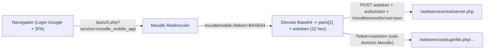

# Documentación técnica · Moodle REST (`wstoken` y `server.php`)

Guía práctica para obtener el token móvil oficial de Moodle (compatible con inicio de sesión de Google + 2FA) y consumir el endpoint REST `/webservice/rest/server.php` en modo consulta/descarga sin necesidad de mantener cookies de navegador.

## Contenido

1. **[Cómo conseguir y decodificar el token (`wstoken`)](01-conseguir-token.md)**
   - Por qué usar el flujo móvil oficial frente a cookies de sesión
   - Cómo abrir `launch.php` y capturar el enlace `moodlemobile://token=...`
   - Cómo decodificar el Base64 para extraer el `wstoken` hexadecimal (con Python o terminal `bash`)
2. **[Cómo hacer peticiones a `server.php`](02-peticiones-server-php.md)**
   - Estructura HTTP (`POST`, parámetros obligatorios y formato de listas)
   - Catálogo de funciones (`wsfunction`) para tareas, cuestionarios, notas, calendario y foros con ejemplos `curl` y JSON real
   - Ejemplo completo en Python para listar entregas y notas
   - Descarga autenticada de archivos desde `webservice/pluginfile.php`
   - Errores comunes (`invalidtoken`, permisos por curso) y cómo detectarlos

## Diagrama rápido



> **Seguridad:** Nunca subas tu `wstoken` ni tu archivo `.env` a GitHub. Ese token da acceso completo a tu cuenta de Moodle dentro de los permisos del servicio móvil.

## Licencia y mención obligatoria

Este repositorio está publicado bajo **[Creative Commons Attribution 4.0 International (CC BY 4.0)](LICENSE)**.

- **Uso libre:** puedes copiar, modificar, adaptar y usar esta guía y sus ejemplos de código para crear tus propios programas, bots o integraciones (incluidos proyectos comerciales).
- **Atribución obligatoria:** si utilizas esta documentación o construyes programas basándote en ella, debes **mencionar explícitamente al autor (`borchi` · [@mborchi](https://github.com/mborchi))** y enlazar a [moodle-rest-api-guide](https://github.com/mborchi/moodle-rest-api-guide) en el `README`, créditos o documentación de tu proyecto.

Ejemplo de mención:
```text
Basado en la guía de Moodle REST API de borchi (https://github.com/mborchi/moodle-rest-api-guide), bajo licencia CC BY 4.0.
```
